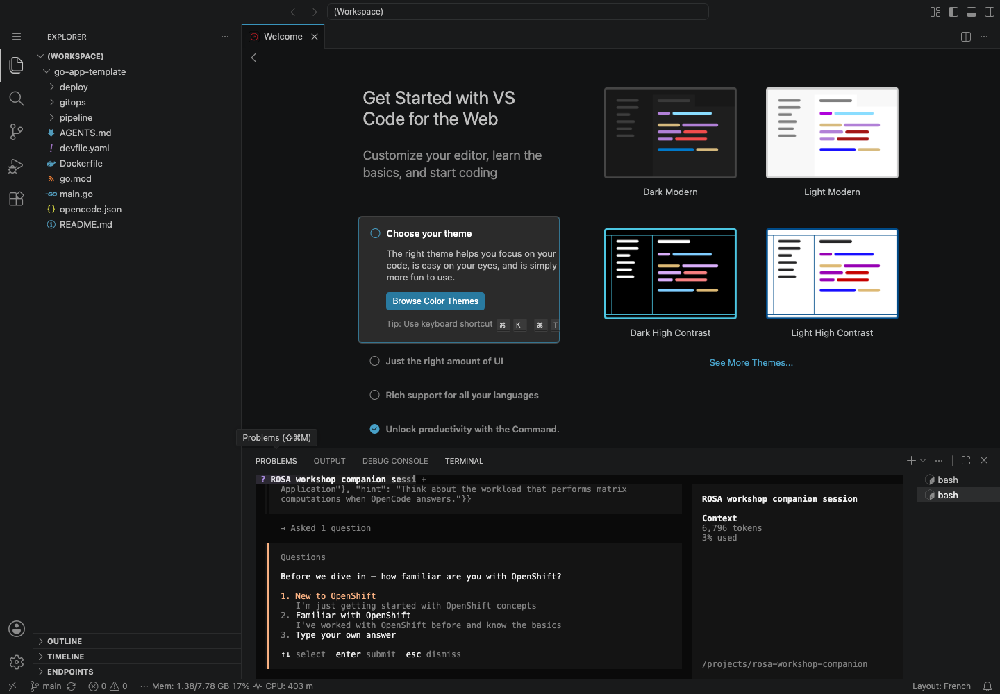
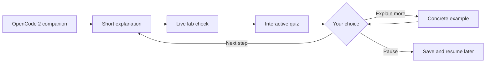

# ROSA workshop companion — OpenCode 2 experiment

A conversational guide to the **already deployed ROSA AI workshop**. OpenCode
2.1.2 uses the cluster's Qwen3.8 endpoint, explains one checkpoint, checks the
live lab, and asks a short quiz. You choose **Next step**, **Explain more**, or
**Pause here**. It follows your language.

## Try it in the existing Dev Space

The experiment is installed at `/projects/rosa-workshop-companion`:

```sh
cd /projects/rosa-workshop-companion
./start
```

It opens the OpenCode 2 terminal interface and starts the companion. Answer the
experience question, then explore the GPU, platform operators, MaaS, Dev Spaces,
Tekton/Argo CD, and GPU/token metrics. Quiz feedback appears after your answer.
A failed quiz or failed live check keeps you on the current checkpoint.



`Pause here` ends the exchange. Run `./start --continue` to reopen the latest
conversation. The current checkpoint is also saved in `.progress.json`, so a
new conversation can resume it. The `/workshop` command starts or resumes the
companion from within this project.

## Install another copy

Use the existing workshop Dev Space with its injected `OPENAI_BASE_URL` and
`OPENAI_API_KEY`, authenticated `oc`, and cluster-admin access:

```sh
git clone --branch experiment/opencode2-companion \
  https://github.com/fjcloud/rosa-ai-app-platform rosa-companion
cd rosa-companion/experiments/opencode-companion
bash install.sh
./start
```

The installer checks the pinned Linux x64 package's SHA-512 integrity and stores
the binary at `~/.local/share/rosa-companion/opencode2`. Runtime configuration,
cache, and session data stay under `.runtime/`. The companion has its own
configuration and the existing injected `opencode` binary keeps its version.

## How it works



| File | Purpose |
|------|---------|
| `.opencode/agents/companion.md` | Primary agent and tool permissions |
| `.opencode/skills/rosa-companion/SKILL.md` | Teaching, questions, hints, and pacing |
| `course.json` | Six checkpoints mapped to the existing workshop labs |
| `companion.py` | Read-only cluster checks, quiz grading, and saved progress |
| `opencode.json` | Native V2 configuration for the existing MaaS model |

The agent can ask native interactive questions and invoke the course controller.
It cannot install, scale, rebuild, or delete cluster resources. The controller
sends one small model request when checking MaaS. It reads the existing
`fortune-cookie` application, so this experiment is an interactive exploration
of the working lab rather than a fresh provisioning run.

This prototype targets the existing administrator workspace. Set
`WORKSHOP_WORKSPACE_NAMESPACE` before starting if its namespace differs from
`cluster-admin-devspaces`. `APP_NAME` defaults to `fortune-cookie`. It has not
been tested as a multi-participant or ARO deployment.

## Skills considered

- [TuTor](https://github.com/kevinnio/tutor): small, step-by-step coaching with
  read-only verification. Its strict homework rules do not cover the workshop's
  existing delivery workflow.
- [opencode-learn](https://github.com/bojackduy/opencode-learn): a broader teaching
  and graded-quiz plugin with additional logging and visual tools.

This experiment uses an original workshop skill and OpenCode's native
[`question`](https://opencode.ai/v2/docs/tools/#question),
[`skills`](https://opencode.ai/v2/docs/skills/), and
[`agent`](https://opencode.ai/v2/docs/agents/) features. No third-party teaching
plugin is required.

## Tests

```sh
python3 -m unittest -v test_companion.py
```

These tests cover advancement gates, wrong answers, explicit next, durable
progress, failed rechecks, and avoiding credential disclosure in unexpected
errors. Live OpenCode 2 and native-question checks are recorded in
`VALIDATION.md`.
