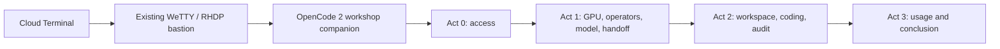

# Whole workshop companion — OpenCode 2 in Cloud Terminal

Open **Cloud Terminal**, connect to the assigned RHDP environment, then run:

```sh
workshop
```

OpenCode **2.1.2 runs on the bastion** and guides the whole workshop from Act 0.
The compact terminal view keeps explanations and questions readable. It explains
a lab, shows commands from the actual workshop guide, offers
inspection or execution, checks the result and asks a short quiz. You choose
**Next step**, **Explain more**, or **Pause here**. It follows your language.

[Open Cloud Terminal](https://fjcloud.github.io/cloud-terminal-pages/#workshop=rosa-ai-app-platform&id=7db2ag)
with the facilitator's assigned email and workshop password. The command is
already installed on the running test lab's bastion.



Dev Spaces is a later workshop exercise. The companion stays in Cloud Terminal
while you open the developer workspace for the coding labs, then verifies the
results from the bastion.


## How an exchange works

1. Short explanation of the current lab and a command from its actual guide.
2. **Inspect this step**, **Run this step**, **Explain more**, or **Pause here**.
3. A live check and a one-question quiz. Wrong answers get a hint and stay put.
4. **Next step** advances only after your choice. Pause saves your checkpoint.

On this already deployed lab, inspection reuses the existing GPU, operators,
model and application. Supported platform actions are routed through the course
controller; browser and coding actions show the current guide's instructions.
The companion does not silently replay installations or rebuild the app.

Run `workshop --continue` to reopen the last conversation. The checkpoint also
persists in `.progress.json`; `/workshop` resumes the guide within OpenCode.

## Install on another prepared bastion

The experiment needs the existing RHDP cluster, bastion tools, administrator
access and an **already available MaaS model**. It loads the current API key
from the existing workshop Secret into process memory; no key is displayed,
rotated or written into the source.

```sh
cd "$HOME"
git clone --branch experiment/opencode2-companion \
  https://github.com/fjcloud/rosa-ai-app-platform rosa-companion-src
cd rosa-companion-src/experiments/opencode-companion
bash install.sh
./start
```

The installer verifies the pinned Linux x64 package's SHA-512 integrity and
stores the binary at `~/.local/share/rosa-companion/opencode2`. Runtime config,
cache and session data stay in `.runtime/`. If the companion is copied out of
the repository, set `WORKSHOP_REPO` to the local workshop checkout.

**Bootstrap limit:** this test uses Qwen already running in the lab. A fresh
workshop needs a model endpoint accessible before the learner deploys their own
model in Lab 1.3. This prototype does not solve that initial model dependency.

## Files and skills

| File | Purpose |
|------|---------|
| `.opencode/agents/companion.md` | Global workshop persona and tool permissions |
| `.opencode/skills/rosa-companion/SKILL.md` | Teaching, lab actions, quiz, pacing and Dev Spaces handoff |
| `course.json` | Ten checkpoints mapped to Acts 0–3 and the conclusion |
| `companion.py` | Actual guide pages, live checks, supported actions and saved progress |
| `launcher.py` | Load the existing MaaS configuration in memory on the bastion |
| `opencode.json` | Native OpenCode 2 provider configuration |

Reviewed [TuTor](https://github.com/kevinnio/tutor) for step-by-step coaching and
[opencode-learn](https://github.com/bojackduy/opencode-learn) for teaching/quiz
features. This experiment uses an original workshop skill with native OpenCode
[`questions`](https://opencode.ai/v2/docs/tools/#question),
[`skills`](https://opencode.ai/v2/docs/skills/) and
[`agents`](https://opencode.ai/v2/docs/agents/).

## Validation

```sh
python3 -m unittest -v test_companion.py
```

See [VALIDATION.md](VALIDATION.md) for actual bastion and Cloud Terminal checks.
This is a single-lab experiment, not an ARO or multi-participant validation.
